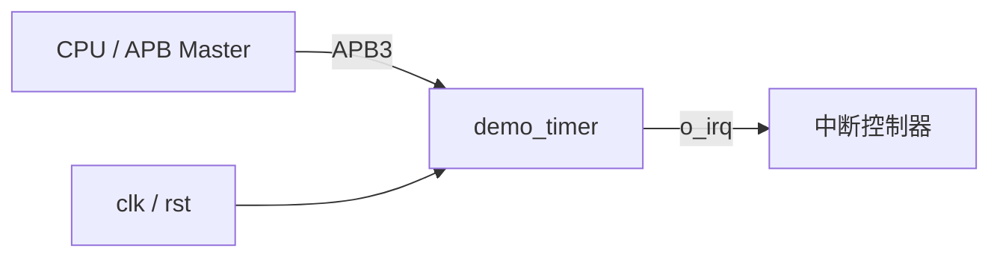

# demo_timer 功能规格

## 1. 概述 (Overview)

`demo_timer` 是一个挂在 APB 总线上的 32 bit 定时器。软件写入比较值并使能后，计数器每个时钟周期加 1；计数值达到比较值时产生到时事件，置位中断状态并（在使能时）拉高 `o_irq`。支持单次与周期两种模式。



## 2. 特性列表 (Features)

| 特性 | 说明 | 覆盖需求 |
|---|---|---|
| APB3 从接口 | 12 bit 地址、32 bit 数据，零等待，非法地址返回 `pslverr` | REQ-IF-001, REQ-IF-002 |
| 32 bit 计数器 | 使能时每周期加 1 | REQ-FUNC-001 |
| 比较到时 | 计数值 ≥ `CMP.VAL` 时到时，周期 `CMP.VAL` + 1 | REQ-FUNC-002, REQ-FUNC-004 |
| 单次 / 周期模式 | 由 `CTRL.MODE` 选择 | REQ-FUNC-003, REQ-FUNC-004 |
| 电平中断 | 可屏蔽，写 1 清除 | REQ-FUNC-005 |
| 计数清零 | 写 `CTRL.CLR` = 1 使计数值归零 | REQ-FUNC-006 |
| 确定的复位状态 | 复位后计数停止，中断为低 | REQ-REG-001 |

## 3. 工作原理 (Theory of Operation)

### 3.1 计数

> 覆盖需求: REQ-FUNC-001

计数器 `COUNT.VAL` 为 32 bit。`CTRL.EN` = 1 时每个 `clk` 周期加 1；`CTRL.EN` = 0 时保持当前值（暂停）。清零 `CTRL.EN` 不会使计数值归零，再次使能时从当前值继续计数。软件写 `COUNT` 无效；如需清零计数值，使用 `CTRL.CLR`（§3.6）。

### 3.2 到时事件

> 覆盖需求: REQ-FUNC-002

当 `CTRL.EN` = 1 且 `COUNT.VAL` ≥ `CMP.VAL` 时，当前周期产生一次到时事件：

1. 下一周期 `COUNT.VAL` 归零；
2. 下一周期 `INTR_STATE.EXPIRED` 置 1。

采用「≥」而非「=」比较（见 DEC-001）：软件在运行中把 `CMP.VAL` 改到小于当前计数值时，定时器会立即到时，而不会一直计数到 32 bit 回绕。

`CTRL.EN` 从 0 变 1 后的第一个周期计数值为 0，因此从使能生效到到时事件共经过 `CMP.VAL` + 1 个周期。下图为单次模式、`CMP.VAL` = 3、`INTR_ENABLE.EXPIRED` = 1 的时序（周期 0 为写 `CTRL` 的 APB 访问阶段）：

```wavedrom
{ "signal": [
  { "name": "clk",              "wave": "p......." },
  { "name": "CTRL.EN",            "wave": "01...0.." },
  { "name": "COUNT.VAL",          "wave": "=.====..", "data": ["0", "1", "2", "3", "0"] },
  { "name": "到时事件 (内部)",     "wave": "0...10.." },
  { "name": "INTR_STATE.EXPIRED", "wave": "0....1.." },
  { "name": "o_irq",              "wave": "0....1.." }
]}
```

### 3.3 单次模式

> 覆盖需求: REQ-FUNC-003

`CTRL.MODE` = 0 (ONESHOT)。到时事件发生时，硬件在下一周期将 `CTRL.EN` 清零，计数值停在 0。软件可再次写 `CTRL.EN` = 1 重新启动。

若软件写 `CTRL` 的访问阶段恰好与到时事件同周期，以软件写入值为准（见 DEC-002）。

### 3.4 周期模式

> 覆盖需求: REQ-FUNC-004

`CTRL.MODE` = 1 (PERIODIC)。到时后计数值归零并继续计数，`CTRL.EN` 保持为 1。相邻两次到时事件间隔 `CMP.VAL` + 1 个周期；`CMP.VAL` = 0 时每个周期都产生到时事件。

### 3.5 寄存器访问

> 覆盖需求: REQ-IF-001, REQ-IF-002, REQ-REG-002

- 每次 APB 传输包含一个建立周期和一个访问周期，`o_pready` 恒为 1，不插入等待。
- 写操作在访问周期结束时的时钟上升沿生效；读数据 `o_prdata` 在访问周期内有效。
- 地址必须为已映射且 4 字节对齐的地址（`0x000`、`0x004`、`0x008`、`0x00C`、`0x010`）。其他地址在访问周期拉高 `o_pslverr`，读返回 0，写被忽略。
- 不支持字节写（APB3 无 `pstrb`），所有写均为 32 bit 整字写。

### 3.6 计数清零

> 覆盖需求: REQ-FUNC-006

软件对 `CTRL.CLR` 写 1 时，计数值在下一周期归零（写 0 无影响），`CTRL.CLR` 读为 0。清零不改变 `CTRL.EN`、`CTRL.MODE` 与中断状态：

- 运行中清零：下一周期计数值为 0，之后继续计数，相当于重新开始一次定时；
- 停止时清零：计数值变为 0 并保持。

`CLR` 与 `EN`、`MODE` 位于同一寄存器（见 DEC-005），因此写 `CLR` 时会同时写入 `EN` 和 `MODE`，软件应采用读-改-写。`CTRL.CLR` 与到时事件同周期时，计数值归零，到时事件照常置位 `INTR_STATE.EXPIRED`。

## 4. 工作模式与状态 (Modes)

| 状态 | 条件 | 行为 |
|---|---|---|
| 停止 | `CTRL.EN` = 0 | 计数保持，不产生到时事件 |
| 运行-单次 | `CTRL.EN` = 1，`CTRL.MODE` = 0 | 计数，到时后回到「停止」 |
| 运行-周期 | `CTRL.EN` = 1，`CTRL.MODE` = 1 | 计数，到时后继续「运行-周期」 |

运行中修改 `CTRL.MODE` 立即生效，影响下一次到时事件的行为。

## 5. 时钟与复位行为 (Clock & Reset Behavior)

> 覆盖需求: REQ-REG-001

- 单时钟域，所有逻辑工作在 `clk` 上升沿。
- `rst` 为低（复位有效）时所有寄存器异步复位为 04_registers 中的复位值：`CTRL.EN` = 0，`COUNT.VAL` = 0，`CMP.VAL` = `0xFFFFFFFF`，中断状态和使能均为 0。
- 复位期间及复位释放后，在软件使能前计数器不会计数，`o_irq` 保持为低。

## 6. 中断与错误处理 (Interrupts & Errors)

> 覆盖需求: REQ-FUNC-005

- `o_irq` = `INTR_STATE.EXPIRED` & `INTR_ENABLE.EXPIRED`，为电平型，高有效。
- `INTR_STATE.EXPIRED` 由到时事件置位，软件写 1 清零，写 0 无影响。
- 软件清除与硬件置位发生在同一周期时，置位优先，保证不丢中断（见 DEC-003）。
- `INTR_ENABLE.EXPIRED` 只屏蔽 `o_irq`，不影响 `INTR_STATE.EXPIRED` 的置位，软件可轮询。
- 总线错误处理见 §3.5。

## 7. 性能指标 (Performance)

| 指标 | 数值 | 条件 | 覆盖需求 |
|---|---|---|---|
| 工作频率 | 100 MHz | 单时钟域 | REQ-PERF-001 |
| 定时范围 | 1 ~ 2^32 个周期 | `CMP.VAL` = 0 ~ `0xFFFFFFFF` | REQ-FUNC-004 |
| 最长定时 | 约 42.95 s | 100 MHz，`CMP.VAL` = `0xFFFFFFFF` | |
| APB 访问延迟 | 2 cycles | 建立 + 访问，零等待 | REQ-IF-001 |
| 到时到 `o_irq` 延迟 | 1 cycle | 到时事件周期的下一周期 | REQ-FUNC-005 |

## 8. 接口与寄存器引用 (Interfaces & Registers)

端口与参数详见 [03_interfaces.md](03_interfaces.md)，寄存器详见 [04_registers.md](04_registers.md)。协议约定见 §3.5。

## 9. 限制与已知问题 (Limitations)

- 无预分频器，定时分辨率固定为 1 个 `clk` 周期。
- 写 `CTRL.CLR` 会同时写入 `CTRL.EN` 与 `CTRL.MODE`，软件需读-改-写（DEC-005）。
- `CMP.VAL` = 0 且周期模式时，`INTR_STATE.EXPIRED` 每周期被置位，软件清除无效（置位优先），属预期行为。
