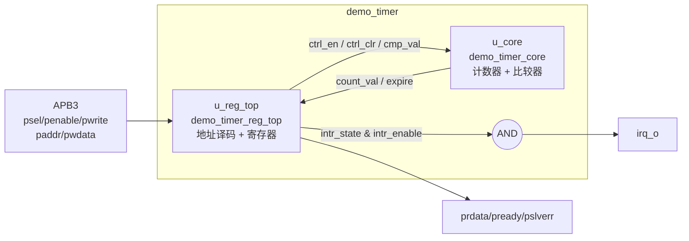
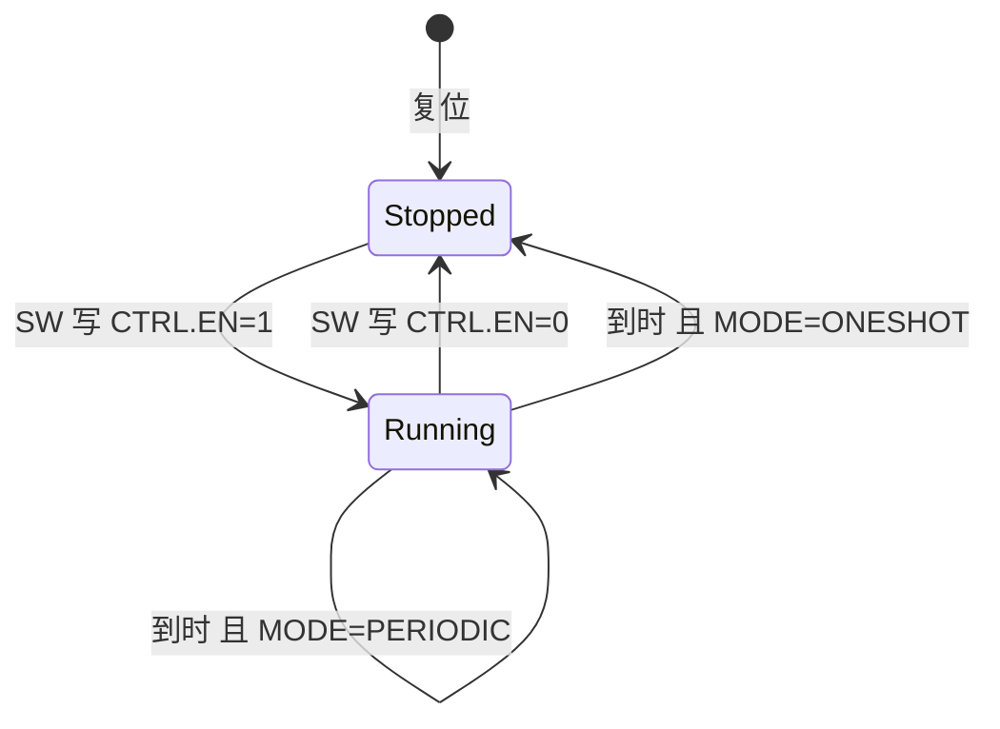

# demo_timer 微架构

## 1. 顶层框图 (Block Diagram)



## 2. 子模块划分 (Sub-modules)

| 子模块 | 实例名 | 职责 | 关键接口 |
|---|---|---|---|
| `demo_timer_reg_top` | `u_reg_top` | APB 协议处理、地址译码、`CTRL`/`CMP`/`INTR_STATE`/`INTR_ENABLE` 寄存器、读数据选择、`pslverr` 生成、硬件对 `CTRL.EN` 和 `INTR_STATE.EXPIRED` 的更新 | 输出 `ctrl_en_o`、`ctrl_clr_o`、`cmp_val_o`、`intr_state_o`、`intr_enable_o`；输入 `count_val_i`、`expire_i` |
| `demo_timer_core` | `u_core` | 32 bit 计数器（即 `COUNT.VAL`）、计数清零、到时比较、到时脉冲 | 输入 `en_i`、`clr_i`、`cmp_i`；输出 `count_o`、`expire_o` |
| `demo_timer`（顶层） | — | 连接子模块，生成 `irq_o` | 全部 IP 端口 |

划分理由：寄存器块与功能逻辑分离（与 OpenTitan `*_reg_top` 一致），日后更换总线协议只需替换 `u_reg_top`。

## 3. 数据通路 (Datapath)

- **计数通路**：`count_q`（32 bit）→ 加 1 → 选择器（保持 / 加 1 / 归零）→ `count_q`。
- **比较通路**：`count_q` 与 `cmp_val`（32 bit）做无符号 `>=` 比较，与 `en` 相与得到 `expire`（组合信号，单周期脉冲）。
- **读通路**：`paddr_i` 译码 → 5 选 1 读数据选择器 → `prdata_o`（组合输出，访问周期有效）。
- 无流水线、无缓冲。

## 4. 控制逻辑与状态机 (Control & FSM)

本 IP 无显式状态机，运行状态完全由 `CTRL.EN` 与 `CTRL.MODE` 决定（见 01_spec §4）。各寄存器次态逻辑如下（同一行条件自左向右优先级递增，后者覆盖前者）：

| 寄存器 | 默认 | 条件 1 | 条件 2（最高优先级） |
|---|---|---|---|
| `count_q` | 保持 | `en` → `count_q + 1` | `expire` 或 `clr` → 0 |
| `ctrl_en_q` | 保持 | `expire && mode == ONESHOT` → 0 | 软件写 `CTRL` → `pwdata[0]`（DEC-002） |
| `ctrl_mode_q` | 保持 | — | 软件写 `CTRL` → `pwdata[1]` |
| `cmp_q` | 保持 | — | 软件写 `CMP` → `pwdata` |
| `intr_state_q` | 保持 | 软件写 `INTR_STATE` 且 `pwdata[0]` → 0 | `expire` → 1（DEC-003） |
| `intr_enable_q` | 保持 | — | 软件写 `INTR_ENABLE` → `pwdata[0]` |

其中「软件写 X」= `psel_i & penable_i & pwrite_i & (paddr_i == X 的偏移)`；`clr` = 软件写 `CTRL` 且 `pwdata[2]`，为组合单周期脉冲，不占用触发器（DEC-005）。

运行状态的转移如下：



| 当前状态 | 条件 | 下一状态 | 输出/动作 |
|---|---|---|---|
| Stopped | SW 写 `CTRL.EN` = 1 | Running | 下一周期开始计数 |
| Running | SW 写 `CTRL.EN` = 0 | Stopped | 计数保持 |
| Running | `expire` 且 `MODE` = ONESHOT 且无同拍 SW 写 | Stopped | 计数归零，置位 `EXPIRED` |
| Running | `expire` 且 `MODE` = PERIODIC | Running | 计数归零，置位 `EXPIRED` |

## 5. 时钟与复位方案 (Clocking & Reset)

| 时钟 | 频率 | 驱动的子模块 |
|---|---|---|
| `clk_i` | 100 MHz | 全部 |

- 所有触发器使用 `always_ff @(posedge clk_i or negedge rst_ni)`，异步复位到 04_registers 定义的复位值（ASM-004）。
- 复位同步器位于 IP 外部，`rst_ni` 释放沿已同步到 `clk_i`。
- 全部 68 个触发器均可复位（`CTRL` 2 + `CMP` 32 + `COUNT` 32 + `INTR_STATE` 1 + `INTR_ENABLE` 1）。

## 6. 跨时钟域 (CDC)

| 源时钟 | 目的时钟 | 信号 | 位宽 | 同步方式 |
|---|---|---|---|---|

不适用：单时钟域设计，所有输入（APB 信号）均与 `clk_i` 同步。

## 7. 关键时序 (Key Timing)

APB 写 `CTRL` 启动周期模式，`CMP.VAL` = 1（周期 2 拍），`INTR_ENABLE.EXPIRED` = 1：

```wavedrom
{ "signal": [
  { "name": "clk_i",     "wave": "p........" },
  { "name": "psel_i",    "wave": "01.0....." },
  { "name": "penable_i", "wave": "0.10....." },
  { "name": "ctrl_en_q", "wave": "0..1....." },
  { "name": "count_q",   "wave": "=...=====", "data": ["0", "1", "0", "1", "0", "1"] },
  { "name": "expire",    "wave": "0...10101" },
  { "name": "irq_o",     "wave": "0....1..." }
]}
```

## 8. 面积/时序/功耗估计 (PPA Estimate)

| 项 | 估计 | 依据 |
|---|---|---|
| 触发器数量 | 68 | §5 统计；Yosys 综合实测 68（36 个复位为 0、32 个复位为 1） |
| 组合逻辑 | 497 个二输入通用门 | Yosys 综合实测（`syn/synth.ys`，通用门库，未做工艺映射） |
| 关键路径 | `count_q` → 32 bit `>=` 比较 → `expire` → 计数次态选择 → `count_q` | Yosys `ltp` 实测最长组合路径 32 级二输入门（初估 < 30 级，见 ITR-004） |
| 目标频率 | 100 MHz（10 ns） | REQ-PERF-001；32 级门在常见工艺下约 3~6 ns，预计余量充足，最终以后端 STA 为准 |

## 9. 可测性与调试 (DFT & Debug)

- 全同步设计、所有触发器可复位，可直接插入扫描链。
- 无存储器，不需要 MBIST。
- 调试：`COUNT` 寄存器可读，便于软件观察计数进度。
