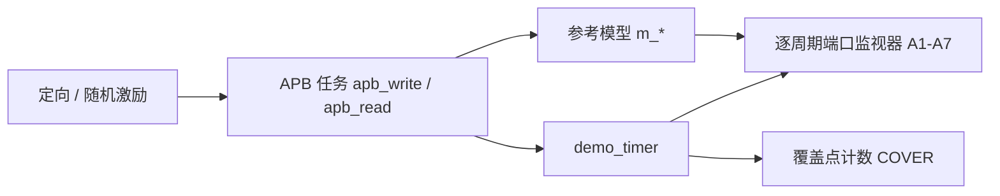

# demo_timer 验证计划

## 1. 验证目标与范围 (Goals & Scope)

**范围内：** 01_spec 描述的全部功能行为、04_registers 定义的全部寄存器、APB 协议响应、DEC-001 ~ DEC-003 规定的优先级。

**范围外：**
- 门级仿真与时序：由后端 STA 覆盖（TP-010 仅做综合可行性评估）。
- 与真实 CPU 的系统级联调。

## 2. 验证环境 (Testbench)

| 项 | 内容 |
|---|---|
| 仿真器 | Icarus Verilog 13.0（`iverilog -g2001`） |
| 方法学 | 黑盒自检查 Verilog-2001 testbench（rtl-coding-style §10）：只通过顶层端口访问 DUT；定向测试 + 参考模型逐周期比对 + 功能覆盖计数 |
| 目录 | `dv/tb/demo_timer_tb.v`、`dv/run_sim.py`、`dv/run_mutation.py` |
| 运行命令 | `python dv/run_sim.py`（全部回归）；`python dv/run_sim.py --test test_oneshot`（单个用例）；`python dv/run_mutation.py`（testbench 有效性检查） |
| 综合评估 | `yowasp-yosys -s syn/synth.ys`（Yosys 通用门库） |

参考模型依据 01_spec 独立编写（单个 `always` 块描述全部状态，不复用 RTL 的模块划分与内部信号），每个时钟下降沿与 DUT 顶层端口比对。testbench 不使用 `U_dut.xxx` 层次引用：内部状态（计数值、寄存器字段）通过 APB 读回与参考模型比对（A7），中断状态通过 `o_irq` 比对（A6）；到时时刻通过 `o_irq` 上升沿与 TB 自带的时钟沿计数器 `cyc` 测量。构造同拍冲突时按参考模型的计数值 `m_cnt` 对齐访问周期（`wait_count`）。

## 3. 测试点 (Test Points)

| ID | 描述 | 覆盖需求 | 激励 | 检查方法 | 用例 | 状态 |
|---|---|---|---|---|---|---|
| TP-001 | 复位值正确；复位后不计数；运行中复位能恢复到复位值 | REQ-REG-001 | 读全部寄存器；空闲 50 周期；周期模式运行中拉低 `rst` | 读值与 yaml `resval` 比对；监视器 A1 | `test_reset` | 通过 |
| TP-002 | 寄存器读写；保留位读 0；`COUNT` 只读 | REQ-REG-002, REQ-IF-001 | 写全 1 / 交替图案后回读 | 读值比对；`o_pready` 恒 1（A3） | `test_reg_rw` | 通过 |
| TP-003 | 非法 / 非对齐地址返回 `pslverr`，读 0，写无效 | REQ-IF-002 | 访问 `0x014`、`0x100`、`0xFFC`、`0x001`、`0x002`、`0x006` | `o_pslverr` 期望值；之后回读寄存器未被改写；A4、A5 | `test_apb_err` | 通过 |
| TP-004 | 单次模式：使能后正好 `CMP.VAL` + 1 个周期到时，EN 自动清零，之后不再触发，可重新启动 | REQ-FUNC-001, REQ-FUNC-002, REQ-FUNC-003 | `CMP.VAL` = 9、0、37 `o_irq` 拉高前的时钟沿数与期望值比对；回读 `CTRL`、`COUNT`、`INTR_STATE`；清除后空闲 3 × `CMP.VAL` + 10 周期，`o_irq` 保持低、`INTR_STATE` 读 0 | `test_oneshot` | 通过 |
| TP-005 | 中断屏蔽、轮询、写 0 无效、写 1 清除 | REQ-FUNC-005 | 先关中断到时，再开 / 关 / 清 | `o_irq` 电平；回读 `INTR_STATE`；A6 | `test_irq` | 通过 |
| TP-006 | 周期模式：相邻到时间隔为 `CMP.VAL` + 1；EN 保持；暂停后从原值继续 | REQ-FUNC-001, REQ-FUNC-004 | `CMP.VAL` = 4、13 各测 6 次 `o_irq` 上升沿间隔（每次拉高后立即 W1C）；`CMP.VAL` = 0；暂停 10 周期后恢复 | 间隔逐次比对；`CMP.VAL` = 0 时每拍到时，检查 `COUNT` 恒读 0 且 W1C 后 `INTR_STATE` 仍为 1；回读 `COUNT` | `test_periodic` | 通过 |
| TP-007 | 运行中把 `CMP.VAL` 改到计数值以下立即到时 | REQ-FUNC-002 | 计数到约 50 时写 `CMP.VAL` = 10 | 写入沿时 `o_irq` 仍为 0，下一个沿 `o_irq` = 1；随后 W1C 能清除（只到时一次） | `test_cmp_boundary` | 通过 |
| TP-008 | 同拍冲突优先级：W1C 与到时同拍置位优先（DEC-003）；单次到时与写 `CTRL` 同拍软件优先（DEC-002） | REQ-FUNC-003, REQ-FUNC-005 | 用 `wait_count` 精确对齐访问周期与到时周期 | 冲突后回读 `INTR_STATE` = 1；回读 `CTRL.EN` = 1，且写入沿后第 10 个沿 `o_irq` 拉高（从 0 重新计时） | `test_priority` | 通过 |
| TP-009 | 随机读写（含非法 / 非对齐地址、小比较值、随机 `CTRL.CLR`）下全部行为与参考模型一致 | REQ-FUNC-001, REQ-FUNC-002, REQ-FUNC-003, REQ-FUNC-004, REQ-FUNC-005, REQ-FUNC-006, REQ-IF-001, REQ-IF-002, REQ-REG-002 | 3000 次随机 APB 访问 × 5 个种子 | 监视器 A1 ~ A7 | `test_random` | 通过 |
| TP-010 | 综合可行性：无 latch，逻辑深度满足 100 MHz | REQ-PERF-001 | `syn/synth.ys` | 无 latch 断言；`ltp` 最长路径 | — | 通过（综合评估）；STA 转后端 |
| TP-011 | 计数清零：运行中 / 停止时清零；与到时同拍；不影响中断状态；`CTRL.CLR` 读为 0 | REQ-FUNC-006 | 读-改-写 `CTRL` 置 `CLR`；`wait_count` 对齐到时周期 | 清零后回读 `COUNT`、`CTRL`、`INTR_STATE`；A7 | `test_clr` | 通过 |

> 状态取值：未开始 / 进行中 / 通过 / 失败。

## 4. 断言 (Assertions)

按 DEC-004，以下检查在 testbench 逐周期监视器中实现（`demo_timer_tb.v`，下降沿采样）：

| 断言 | 位置 | 说明 |
|---|---|---|
| A1 | 监视器 | 复位期间 `o_irq` 为低 |
| A2 | 监视器 | 复位释放后输出无 X |
| A3 | 监视器 | `o_pready` 恒为 1 |
| A4 | 监视器 | `o_pslverr` 只在访问周期出现 |
| A5 | 监视器 | 访问周期 `o_pslverr` = 地址非法 |
| A6 | 监视器 | `o_irq` = 参考模型的 `INTR_STATE.EXPIRED` & `INTR_ENABLE.EXPIRED`（逐周期） |
| A7 | 监视器 | 读访问 `o_prdata` 与参考模型一致（计数值与全部寄存器字段经此比对） |

> 1.2 版的 A7（用层次引用逐周期比对内部计数值、寄存器与到时脉冲）已在 ITR-009 删除，原 A8 改为 A7。

## 5. 覆盖率目标 (Coverage Goals)

| 类型 | 目标 | 结果 |
|---|---|---|
| 测试点 | 100% 通过 | 11/11 |
| 功能覆盖点 | 100% 命中 | 见 §5.1 |
| testbench 有效性 | 变异测试全部被检出 | 7/7，见 08_iteration_log ITR-003、ITR-005、ITR-009 |
| 代码覆盖率（line/branch） | ≥ 95% | 不适用：iverilog 不支持代码覆盖率，以功能覆盖点 + 变异测试替代；迁移到商用仿真器后补充 |

### 5.1 功能覆盖点

| 覆盖点 | 含义 |
|---|---|
| `expire_oneshot` / `expire_periodic` | 两种模式下的到时事件 |
| `set_vs_clear` | W1C 与到时同拍（DEC-003） |
| `sw_vs_hw_en` | 单次到时与写 `CTRL` 同拍（DEC-002） |
| `err_read` / `err_write` | 非法地址读 / 写 |
| `cmp_zero_periodic` | 周期模式 `CMP.VAL` = 0 |
| `cmp_below_count` | 运行中把 CMP 改到计数值以下（DEC-001） |
| `irq_masked` | 中断状态置位但被屏蔽 |
| `pause_resume` | 暂停后从原值恢复计数 |
| `clr_running` / `clr_stopped` | 运行中 / 停止时写 `CTRL.CLR` |
| `clr_vs_expire` | `CTRL.CLR` 与到时同拍 |

## 6. 需求追溯矩阵 (Traceability)

| 需求 | 测试点 | 状态 |
|---|---|---|
| REQ-IF-001 | TP-002, TP-009 | 通过 |
| REQ-IF-002 | TP-003, TP-009 | 通过 |
| REQ-PERF-001 | TP-010 | 通过（综合评估），STA 转后端 |
| REQ-FUNC-001 | TP-004, TP-006, TP-009 | 通过 |
| REQ-FUNC-002 | TP-004, TP-007, TP-009 | 通过 |
| REQ-FUNC-003 | TP-004, TP-008, TP-009 | 通过 |
| REQ-FUNC-004 | TP-006, TP-009 | 通过 |
| REQ-FUNC-005 | TP-005, TP-008, TP-009 | 通过 |
| REQ-FUNC-006 | TP-011, TP-009 | 通过 |
| REQ-REG-001 | TP-001 | 通过 |
| REQ-REG-002 | TP-002, TP-009 | 通过 |

## 7. 回归策略 (Regression)

- **每次 RTL 或 testbench 修改**：`python dv/run_sim.py`（9 个定向用例 + `test_random` 5 个种子），要求全部通过且覆盖点全部命中。
- **testbench 修改后**：额外运行 `python dv/run_mutation.py`，要求全部变异被检出。
- **签核前**：`test_random` 使用 `--seeds 50` 运行一次。
