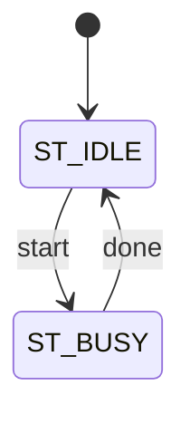

# {{ip}} 微架构

## 1. 顶层框图 (Block Diagram)


## 2. 子模块划分 (Sub-modules)

| 子模块 | 实例名 | 职责 | 关键接口 |
|---|---|---|---|
| {{module}} | `U_{{去掉 IP 前缀的模块名}}` | {{职责}} | {{信号}} |

## 3. 数据通路 (Datapath)

{{数据流向、位宽、流水级数、缓冲深度及其依据。}}

## 4. 控制逻辑与状态机 (Control & FSM)



| 当前状态 | 条件 | 下一状态 | 输出/动作 |
|---|---|---|---|
| ST_IDLE | `start` | ST_BUSY | {{动作}} |

## 5. 时钟与复位方案 (Clocking & Reset)

| 时钟 | 频率 | 驱动的子模块 |
|---|---|---|
| `clk` | {{x}} MHz | 全部 |

{{复位方案、复位同步器位置、复位后初始值策略。}}

## 6. 跨时钟域 (CDC)

| 源时钟 | 目的时钟 | 信号 | 位宽 | 同步方式 |
|---|---|---|---|---|

{{单时钟域设计写「不适用：单时钟域」。}}

## 7. 关键时序 (Key Timing)

```wavedrom
{ "signal": [
  { "name": "clk", "wave": "p......" },
  { "name": "start", "wave": "010...." }
]}
```

## 8. 面积/时序/功耗估计 (PPA Estimate)

| 项 | 估计 | 依据 |
|---|---|---|
| 触发器数量 | {{x}} | |
| 关键路径 | {{描述}} | |
| 目标频率 | {{x}} MHz | |

## 9. 可测性与调试 (DFT & Debug)

{{扫描链要求、MBIST、调试观测信号。无则写「不适用：<原因>」。}}
