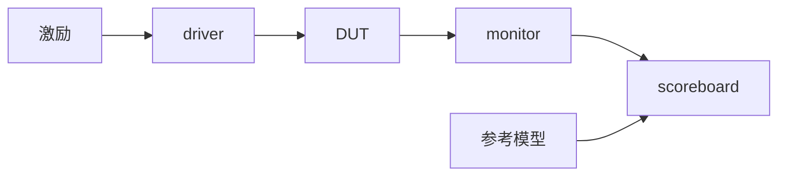

# {{ip}} 验证计划

## 1. 验证目标与范围 (Goals & Scope)

{{验证什么、不验证什么（如后端时序由 STA 覆盖）。}}

## 2. 验证环境 (Testbench)

| 项 | 内容 |
|---|---|
| 仿真器 | {{VCS（run_regress.py）}} |
| 方法学 | {{自检查 SV testbench / cocotb / UVM}} |
| 目录 | `dv/` |
| 运行命令 | `{{make sim TEST=xxx}}` |

## 3. 测试点 (Test Points)

> 字段含义、填写示例和命名规范见 `references/test-plan-template.md`。

### 3.1 测试点列表（Feature / Test Point）

| Feature编号 | Feature描述 | Sub-Feature（子特性）描述 | Test point 测试点 | 测试点编号 | 测试点是否被测试用例覆盖 | 备注 |
| --- | --- | --- | --- | --- | --- | --- |
| {{特性大类，例：时钟复位}} | {{特性描述}} | {{子特性，无则写 —}} | {{测试点描述}} | {{测试点编号，tp_类别_对象_细分}} | {{Yes / No}} | {{补充说明，无则写 —}} |

### 3.2 测试用例列表（Test Case）

#### 用例 1

| 字段 | 内容 |
| --- | --- |
| 测试用例编号 | {{测试用例编号，tc_对象_场景_序号}} |
| 所覆盖测试点编号 | {{测试点编号，多个用 br 换行分隔}} |
| 测试用例标题 | {{用例简要描述}} |
| TC 描述 | {{(1) 步骤一，预期结果A。 (2) 步骤二，预期结果B。}} |
| 预置条件 | {{执行用例前需要准备的配置/环境}} |
| 预期结果 | {{**预期结果A：** ... **预期结果B：** ...}} |
| 优先级 | {{High / Medium / Low}} |
| 测试活动 | {{仿真 / 现场 / FPGA 等}} |
| 测试人员 | {{责任人，无则写 —}} |
| 备注/建议 | {{补充说明，无则写 —}} |

## 4. 断言 (Assertions)

| 断言 | 位置 | 说明 |
|---|---|---|

## 5. 覆盖率目标 (Coverage Goals)

| 类型 | 目标 | 豁免说明 |
|---|---|---|
| 代码覆盖率（line/branch） | ≥ 95% | — |
| 功能覆盖率 | 100% 测试点通过 | — |
| FSM 状态/转移 | 100% | — |

> 代码覆盖率由 VCS 回归采集，只统计 DUT，结果在 `reports/regress.json` 的 `coverage` 中。未达标时回归给出警告，签核时报错；确实无法覆盖的项在「豁免说明」中写明原因。

## 6. 需求追溯矩阵 (Traceability)

| 需求 | 测试点 | 状态 |
|---|---|---|
| {{REQ-xxx}} | {{测试点编号}} | 未开始 |

## 7. 回归策略 (Regression)

{{冒烟集、全量回归、随机种子数量。}}
