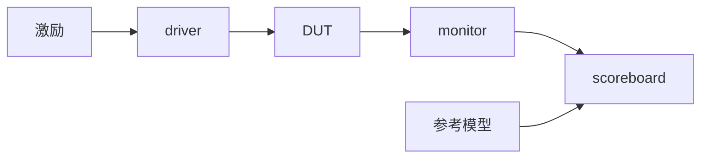

# {{ip}} 验证计划

## 1. 验证目标与范围 (Goals & Scope)

{{验证什么、不验证什么（如后端时序由 STA 覆盖）。}}

## 2. 验证环境 (Testbench)

| 项 | 内容 |
|---|---|
| 仿真器 | {{iverilog / verilator / VCS / Xcelium}} |
| 方法学 | {{自检查 SV testbench / cocotb / UVM}} |
| 目录 | `dv/` |
| 运行命令 | `{{make sim TEST=xxx}}` |

## 3. 测试点 (Test Points)

| ID | 描述 | 覆盖需求 | 激励 | 检查方法 | 用例 | 状态 |
|---|---|---|---|---|---|---|
| TP-001 | {{测试点描述，例：复位后状态}} | {{REQ-xxx}} | {{激励}} | {{检查方法}} | `{{test_xxx}}` | 未开始 |

> 状态取值：未开始 / 进行中 / 通过 / 失败。

## 4. 断言 (Assertions)

| 断言 | 位置 | 说明 |
|---|---|---|

## 5. 覆盖率目标 (Coverage Goals)

| 类型 | 目标 |
|---|---|
| 代码覆盖率（line/branch） | ≥ 95% |
| 功能覆盖率 | 100% 测试点通过 |
| FSM 状态/转移 | 100% |

## 6. 需求追溯矩阵 (Traceability)

| 需求 | 测试点 | 状态 |
|---|---|---|
| {{REQ-xxx}} | TP-00x | 未开始 |

## 7. 回归策略 (Regression)

{{冒烟集、全量回归、随机种子数量。}}
